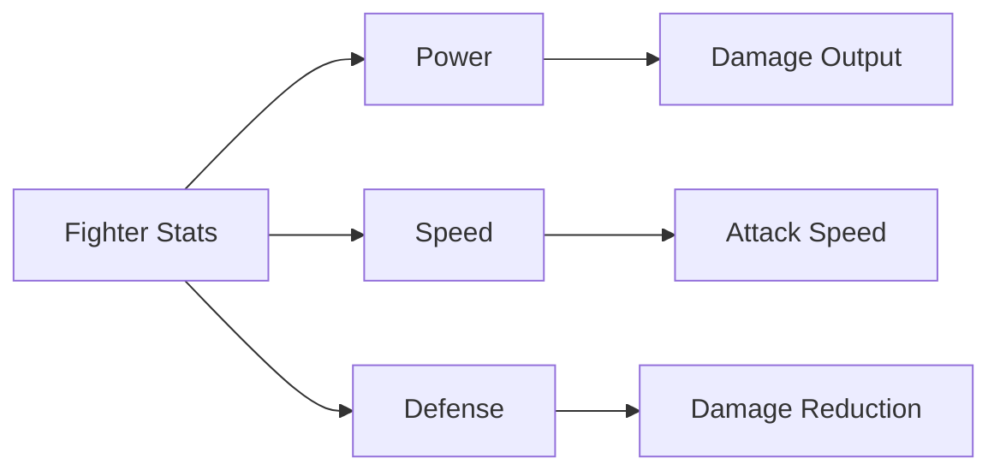
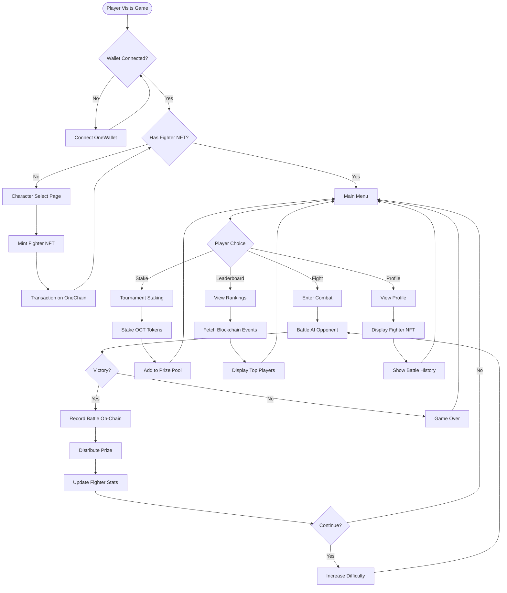
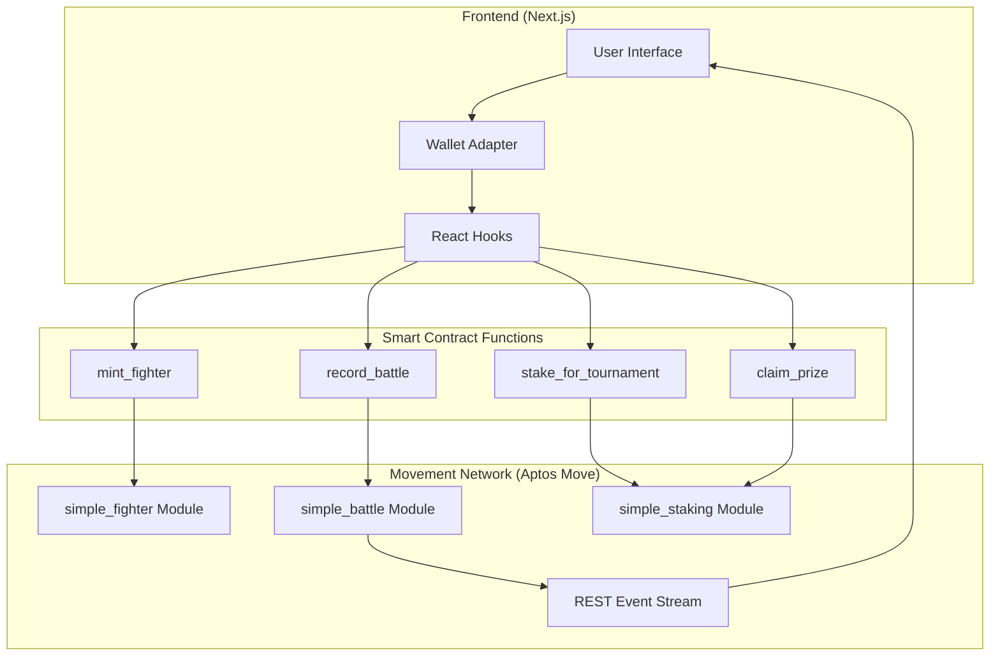
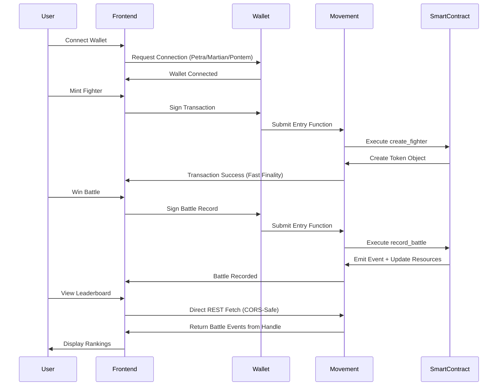

# 🥊 ONE CLASH FIGHTERS:

> **A blockchain-powered retro fighting game on Movement Network**  
> Play-to-Earn • NFT Fighters • On-Chain Battles • Tournament Staking

[](https://movementlabs.xyz)
[](https://nextjs.org)
[](https://www.typescriptlang.org)
[](LICENSE)

---

## 📖 Table of Contents

- [Overview](#overview)
- [Game Features](#game-features)
- [How to Play](#how-to-play)
- [Fighter Roster](#fighter-roster)
- [Game Workflow](#game-workflow)
- [Movement Network Integration](#movement-network-integration)
- [Smart Contracts](#smart-contracts)
- [Installation](#installation)
- [Tech Stack](#tech-stack)
- [Architecture](#architecture)
- [Move Compilation](#move-compilation)

---

## 🎮 Overview

**One Clash Fighters** is a retro-style fighting game that combines classic arcade gameplay with modern blockchain technology. Built on **Movement Network** (Aptos Move-based L1), players mint unique Fighter NFTs, battle AI opponents, stake MOVE tokens in tournaments, and earn rewards based on their performance—all recorded immutably on-chain.

### Key Highlights
- 🎨 **NFT Fighters**: Mint and own unique fighter characters as NFTs (Optional)
- ⚔️ **On-Chain Battles**: Every victory is recorded on the blockchain
- 💰 **Play-to-Earn**: Stake tokens, win battles, claim prizes
- 🏆 **Live Leaderboard**: Real-time rankings from blockchain events (REST-based)
- 🔗 **Fully Decentralized**: All game logic secured by smart contracts
- 🚀 **CORS-Free**: Direct REST API integration for maximum reliability

---
## Gallery 
### Home Page 
A clean, futuristic landing screen where players begin their journey, connect wallets, and explore game modes.


### Select character 
Players choose their fighters, each with unique power stats, abilities, and rarity levels.


### Main Fight 
The core gameplay scene where turn-based combat takes place with animations, attacks, and health tracking.


### You Won 
A victory screen showing battle results, rewards earned, and XP gained.


### Save Record in Blockchain
After each match, battle stats are permanently stored on the Movement Network blockchain for transparency and fairness.


### 


## Profile


### LeaderBord 
Global rankings showcasing top players based on wins, staking power, and on-chain battle history.


### Stacking 
Users can stake tokens inside the game to boost rewards, earn yield, and unlock special characters.


## 🌟 Game Features

### Core Gameplay
- **6 Unique Fighters** with distinct stats and abilities
- **Progressive Difficulty** - AI gets stronger each round
- **Advanced Combat System** - Punch, kick, jump, duck, defense, and special moves
- **Retro Pixel Art** - Classic arcade aesthetics
- **Responsive Controls** - Smooth keyboard-based combat

### Blockchain Features
- **Fighter NFT Minting** - Create your fighter on-chain using Aptos Token Objects
- **Battle Recording** - All victories stored on Movement Network
- **Tournament Staking** - Stake MOVE tokens to enter prize pools
- **Prize Distribution** - Winners claim rewards automatically
- **Transparent Leaderboard** - Rankings verified on blockchain
- **Profile System** - View your NFT fighter and battle history

---

## 🎯 How to Play

### 1️⃣ **Connect Wallet**
- Click "Connect Wallet" on the home screen
- Connect your Movement wallet (Petra, Martian, or Pontem)

### 2️⃣ **Mint Your Fighter (Optional)**
- Navigate to "Character Select"
- Choose from 6 unique fighters
- Mint your fighter NFT to track permanent stats
- *Note: You can also play immediately without minting!*

### 3️⃣ **Enter Combat**
- Select your minted fighter
- Battle against AI opponents
- Use strategic moves to win

### 4️⃣ **Stake & Earn**
- Visit the "Staking" page
- Stake MOVE tokens to enter tournaments
- Win battles to increase your prize pool share

### 5️⃣ **Track Progress**
- Check the "Leaderboard" for rankings
- View your "Profile" to see stats and battle history

---

## 🥋 Fighter Roster

Each fighter has unique stats that affect combat performance:



### Fighter Details

| Fighter | Type | Power | Speed | Defense | Specialty |
|---------|------|-------|-------|---------|-----------|
| ⚡ **Thunder Fist** | Boxer | 9 | 6 | 7 | Heavy punches, high damage |
| 🥷 **Shadow Strike** | Ninja | 7 | 10 | 5 | Lightning fast, swift combos |
| 🤖 **Cyber Warrior** | Tech | 8 | 8 | 6 | Balanced, precision strikes |
| 🎭 **Mystery Fighter** | Enigma | 6 | 7 | 9 | Unpredictable, defensive |
| 👑 **Street King** | Brawler | 7 | 7 | 8 | Well-rounded, solid fundamentals |
| 🛡️ **Iron Wall** | Tank | 8 | 5 | 10 | Defensive powerhouse, unbreakable |

### Combat Controls

| Key | Action | Description |
|-----|--------|-------------|
| **←/→** | Move | Walk left/right |
| **↑** | Jump | Leap over attacks |
| **↓** | Duck | Avoid high kicks |
| **D** | Punch | Quick attack (5 damage) |
| **A** | Kick | Strong attack (10 damage) |
| **S** | Defense | Block incoming damage (1% only) |
| **↑ + A** | Jump Kick | Aerial special (15 damage) |

---

## 🔄 Game Workflow



---

## 🔗 Movement Network Integration

### Why Movement Network?

Movement is a high-performance Layer 1 blockchain built on Aptos Move, offering:

- **⚡ High Throughput**: Parallel execution for smooth gameplay
- **🚀 Low Latency**: Sub-second finality for instant battle results
- **🔒 Security**: Move language's resource-oriented programming prevents common vulnerabilities
- **🎮 Gaming Focus**: Optimized for blockchain gaming applications
- **🛠️ Developer Tools**: Rich Aptos ecosystem and tooling
- **🌐 Interoperability**: Modular architecture for cross-chain features

### Blockchain Architecture



### How It Works

1. **Fighter NFT System (Aptos Token Objects)**
   - Each fighter is a unique token object on Movement Network
   - Implements AIP-22 (Aptos Token Objects standard)
   - Stores stats: name, type, level, wins, losses, damage
   - Minted via `fighter_nft::create_fighter` entry function
   - Owned by player's wallet address

2. **Battle Recording**
   - Every battle result is recorded on-chain
   - Emits `BattleCompleted` event with winner, damage, prize
   - Updates fighter stats using resource mutations
   - Stores battle counter in module resource
   - Utilizes Movement's fast finality for instant results

3. **Tournament Staking**
   - Players stake MOVE tokens (AptosCoin) to enter tournaments
   - Tokens managed in module's global resource
   - Winners claim 90% of pool (10% burned for tokenomics)
   - All transactions verified on Movement Network
   - Leverages Aptos coin framework

4. **Leaderboard System**
   - Fetches `BattleResult` events directly from Movement REST API
   - Bypasses Indexer to avoid CORS and latency issues
   - Aggregates wins, damage, and prizes per player
   - Real-time rankings using direct blockchain state
   - Fully transparent and verifiable on-chain

---

## 📜 Smart Contracts

The game uses three Move smart contract modules deployed on Movement Network:

### 1. Fighter NFT Module (`simple_fighter.move`)
```move
// Creates unique fighter NFTs with stats (Aptos Move)
public entry fun create_fighter(
    account: &signer,
    name: String,
    power: u64,
    speed: u64,
    defense: u64,
)
```

**Features:**
- Mint fighter resources with custom stats
- Track wins, losses, and battle history
- View functions for querying fighter stats

### 2. Battle System Module (`simple_battle.move`)
```move
// Records battle results on-chain (Aptos Move)
public entry fun record_battle(
    account: &signer,
    loser: address,
    winner_power: u64,
    loser_power: u64,
)
```

**Features:**
- Record battle results with winner/loser stats
- Emit `BattleResult` events via REST-compatible EventHandles
- Auto-initializes player records on first victory
- Global battle counter and history

### 3. Staking Pool Module (`simple_staking.move`)
```move
// Stake tokens for tournament entry (Aptos Move)
public entry fun stake_entry(
    account: &signer,
    amount: u64,
)
```

**Features:**
- Global tournament prize pool
- Entry fee: 0.1 MOVE (10,000,000 Octas)
- Track participants and total staked
- Secure vault for tournament funds

---

## 🧾 Proof of Deployment

The smart contracts are live on **Movement Testnet**.

| Item | Value |
|------|-------|
| **Package Address** | `0x234e25fcd07fc478e6d223b72acaf9fa5b1cdc3f4d7dde5b0d1bd1f80f627b0e` |
| **Deployment TX** | `0x5d9ad0a59d80941bff8e31f052a01466ac4615ab90459b383b1937cbd14b52e6` |
| **Pool Init TX** | `0x485699dc3554f822cd8f885334ad1a6b9fca0f4e29b63c6a14fc196924724531` |
| **Network** | Movement Testnet (Chain ID: 250) |

**Explorer Link:** [View on Movement Explorer](https://explorer.movementnetwork.xyz/account/0x234e25fcd07fc478e6d223b72acaf9fa5b1cdc3f4d7dde5b0d1bd1f80f627b0e?network=testnet)

### Contract Deployment

The contracts are deployed on **Movement Testnet**. To deploy your own:

```bash
# Navigate to Move contracts
cd move

# Compile contracts
movement move compile
# or
aptos move compile --named-addresses one_clash_fighters=default

# Test contracts
movement move test
# or
aptos move test --named-addresses one_clash_fighters=default

# Deploy to Movement Network
movement move publish --named-addresses one_clash_fighters=default
# or
aptos move publish --named-addresses one_clash_fighters=default
```

After deployment, update `lib/movement-config.ts` with your package address.

For detailed deployment instructions, see [DEPLOYMENT.md](DEPLOYMENT.md).

---

## 🚀 Installation

### Prerequisites
- Node.js 18+ and npm
- Movement-compatible wallet (Petra, Martian, or Pontem)
- Movement CLI or Aptos CLI
- Movement testnet MOVE tokens (from faucet)

### Setup Steps

1. **Clone the repository**
```bash
git clone https://github.com/yourusername/one-clash-fighters.git
cd one-clash-fighters
```

2. **Install dependencies**
```bash
npm install
```

3. **Configure environment**
```bash
# Copy example env file
cp .env.local.example .env.local

# Edit .env.local and set:
# NEXT_PUBLIC_MOVEMENT_NETWORK=testnet
# NEXT_PUBLIC_MOVEMENT_RPC_URL=https://testnet.movementnetwork.xyz/v1
# NEXT_PUBLIC_PACKAGE_ADDRESS=0x234e25fcd07fc478e6d223b72acaf9fa5b1cdc3f4d7dde5b0d1bd1f80f627b0e
```

4. **Deploy smart contracts** (see [DEPLOYMENT.md](DEPLOYMENT.md))
```bash
cd move
movement move publish --named-addresses one_clash_fighters=default
```

5. **Run development server**
```bash
npm run dev
```

6. **Open in browser**
```
http://localhost:3000
```

### Get Testnet Tokens

Visit the Movement faucet to get testnet MOVE tokens:
- Faucet: https://faucet.testnet.movementlabs.xyz
- Or use CLI: `movement account fund-with-faucet --account default`

### Build for Production
```bash
npm run build
npm start
```

---

## 🛠️ Tech Stack

### Frontend
- **Framework**: Next.js 14 (App Router)
- **Language**: TypeScript 5
- **Styling**: Tailwind CSS v3
- **UI Components**: Custom retro-styled components
- **State Management**: React Hooks + TanStack Query

### Blockchain
- **Network**: Movement Network Testnet (Aptos Move-based)
- **Smart Contracts**: Aptos Move Language
- **Wallet Integration**: @aptos-labs/wallet-adapter-react
- **SDK**: @aptos-labs/ts-sdk
- **Supported Wallets**: Petra, Martian, Pontem
- **Token**: MOVE (Movement native token / AptosCoin)
- **Token Standard**: Aptos Token Objects (AIP-22)

### Development Tools
- **Package Manager**: npm
- **Move CLI**: Movement CLI / Aptos CLI
- **Linting**: ESLint
- **Type Checking**: TypeScript
- **Version Control**: Git

---

## 🏗️ Architecture

### Project Structure
```
one-clash-fighters/
├── app/                    # Next.js app directory
│   ├── page.tsx           # Home/menu page
│   ├── select/            # Character selection
│   ├── fight/             # Combat gameplay
│   ├── winner/            # Battle results
│   ├── leaderboard/       # Rankings page
│   ├── staking/           # Tournament staking
│   └── profile/           # User profile
├── components/            # React components
├── hooks/                 # Custom React hooks
│   ├── use-fighter-nft.ts
│   ├── use-battle-recording.ts
│   └── use-staking.ts
├── lib/                   # Utilities and config
│   ├── movement-config.ts
│   ├── onechain-config.ts # Legacy (deprecated)
│   ├── fighters.ts
│   └── game-utils.ts
├── move/                  # Smart contracts
│   └── sources/
│       ├── fighter_nft.move
│       ├── battle_system.move
│       └── staking_pool.move
├── providers/             # Context providers
│   └── MovementProvider.tsx
└── public/                # Static assets
```

### Data Flow



### Key Architectural Decision: Direct REST vs Indexer
To ensure 100% uptime and bypass CORS restrictions common with public indexers on testnets, **One Clash Fighters** uses a direct REST API integration. By emitting events to a dedicated `EventHandle` within the `simple_battle` module, the frontend can fetch real-time battle data directly from the Movement fullnodes using standard HTTP requests. This architecture ensures that the leaderboard and profile stats are always available, even when indexers are lagging or restricted.

---

## 🎨 Game Mechanics

### Combat System
- **Hit Detection**: Precise collision boxes for each fighter
- **Damage Calculation**: Based on fighter power stat and move type
- **Defense Mechanism**: Blocking reduces damage to 1%
- **Special Moves**: Jump kicks deal 50% more damage
- **AI Behavior**: Adaptive difficulty with strategic decision-making

### Progression System
- **Difficulty Scaling**: Each round increases AI damage by 20%
- **Fighter Leveling**: Win battles to increase fighter level
- **Stat Tracking**: Cumulative damage dealt and taken
- **Win/Loss Record**: Permanent on-chain history

### Economy
- **Mint Fee**: 0.01 MOVE per fighter NFT (configurable)
- **Entry Fee**: 0.1 MOVE to stake in tournaments
- **Prize Pool**: 90% distributed to winners, 10% burned
- **Battle Rewards**: Variable based on performance
- **Token**: MOVE (AptosCoin - Movement native token)

---

## 📊 Leaderboard Metrics

Rankings are calculated from Movement Network blockchain data:

1. **Total Wins** - Number of victories
2. **Total Power** - Cumulative power of the fighter
3. **Last Battle** - Timestamp of most recent fight

All data is fetched from `BattleResult` events directly from the Movement REST API for real-time accuracy and zero CORS issues.

---

## 🤝 Contributing

Contributions are welcome! Please follow these steps:

1. Fork the repository
2. Create a feature branch (`git checkout -b feature/amazing-feature`)
3. Commit your changes (`git commit -m 'Add amazing feature'`)
4. Push to the branch (`git push origin feature/amazing-feature`)
5. Open a Pull Request

---

## 📄 License

This project is licensed under the MIT License - see the [LICENSE](LICENSE) file for details.

---

## 🔗 Links

### Movement Network
- **Website**: [https://movementlabs.xyz](https://movementlabs.xyz)
- **Documentation**: [https://docs.movementnetwork.xyz](https://docs.movementnetwork.xyz)
- **Explorer**: [https://explorer.movementlabs.xyz](https://explorer.movementlabs.xyz)
- **Testnet Faucet**: [https://faucet.testnet.movementlabs.xyz](https://faucet.testnet.movementlabs.xyz)
- **Discord**: [https://discord.gg/movementlabs](https://discord.gg/movementlabs)

### Wallets
- **Petra Wallet**: [https://petra.app](https://petra.app)
- **Martian Wallet**: [https://martianwallet.xyz](https://martianwallet.xyz)
- **Pontem Wallet**: [https://pontem.network](https://pontem.network)

### Resources
- **Aptos Move Book**: [https://aptos.dev/move/move-on-aptos](https://aptos.dev/move/move-on-aptos)
- **Movement Gaming Guide**: [https://blog.movementlabs.xyz/article/Movement-Gaming-Blockchain-Games](https://blog.movementlabs.xyz/article/Movement-Gaming-Blockchain-Games)
- **Movement CLI Guide**: [https://docs.movementnetwork.xyz/devs/tutorials/build](https://docs.movementnetwork.xyz/devs/tutorials/build)

---

## 🙏 Acknowledgments

- Movement Labs team for blockchain infrastructure and gaming support
- Aptos team for the Move language and ecosystem
- Next.js team for the amazing framework
- Retro gaming community for inspiration
- Original OneChain implementation (migrated to Movement)

---

## Move Compilation

The smart contracts are successfully compiled for Movement Network using the Movement CLI. The project includes three main modules:

### ✅ Compilation Status
```bash
cd move && movement move compile
```

**Successfully Compiled Modules:**
- `simple_fighter` - Fighter NFT management
- `simple_battle` - Battle recording and stats
- `simple_staking` - Tournament staking pool

### Framework Dependencies
- **AptosFramework**: Movement's fork of Aptos framework
- **AptosStdlib**: Standard library for Move
- **MoveStdlib**: Core Move standard library

### Contract Features
- ✅ Fighter creation and management
- ✅ Battle result recording
- ✅ Tournament staking system
- ✅ On-chain statistics tracking

---

<div align="center">

**Built with ❤️ on Movement Network**

*Fight. Earn. Dominate.*

</div>
